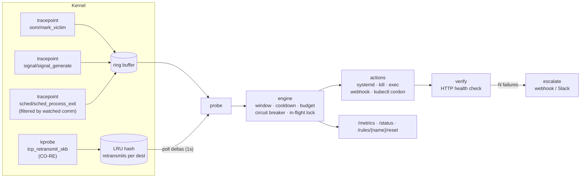

# eBPF-Instrumented Self-Healing Agent

[](https://github.com/mohsinkhanshaik/ebpf-self-healing-agent/actions/workflows/ci.yml)   

`healerd` is a node agent that **watches the kernel with eBPF** for the signals that come before most 2am pages (OOM kills, crash signals, crash-looping processes, lossy network paths) and runs **guarded remediations**. The guardrails stop it from turning a small incident into a big one.

```text
kernel ──eBPF──▶ signals ──▶ rules (threshold / window) ──▶ safety rails ──▶ action ──▶ verify ──▶ escalate
```

## Why

Most auto-remediation is either a cron script that restarts things blindly, or a watchdog polling `/proc` every few seconds and missing what happened between polls. Both share the same failure mode: they keep "fixing" something that isn't getting fixed.

`healerd` takes a different approach:

1. **See it at the source.** Kernel tracepoints and kprobes report the OOM kill, the SIGSEGV or the retransmit at the moment it happens, with the PID, process name and destination. Nothing is sampled or scraped.
2. **Act like a careful SRE, not a cron job.** Every action has a threshold, cooldown, hourly budget, health check and circuit breaker.
3. **Know when to stop.** When remediation keeps failing, or keeps being needed, the agent stops acting, opens the circuit and pages a human with the context.

## Architecture



### Kernel side (`bpf/agent.bpf.c`)

| Signal | Hook | Notes |
|---|---|---|
| `oom_kill` | `tracepoint/oom/mark_victim` | Victim PID; user space reads its name before it is reaped. |
| `crash_signal` | `tracepoint/signal/signal_generate` | Filtered **in the kernel** to SIGSEGV/ABRT/BUS/FPE/ILL/KILL, so SIGCHLD noise never reaches user space. |
| `process_exit` | `tracepoint/sched/sched_process_exit` | Filtered in the kernel against a hash map of watched process names, whole processes only (no threads). Reads `task->exit_code` with **CO-RE**. |
| `tcp_retransmit` | `kprobe/tcp_retransmit_skb` | High volume, so it is **aggregated in an LRU hash** per destination. User space polls deltas instead of taking one event per packet. Reads `struct sock` fields with **CO-RE**, so one binary runs across kernel versions. |

Hooks attach independently. If a kernel lacks one, the agent logs it and runs with the rest.

### Safety rails (`internal/engine`)

| Rail | What it prevents |
|---|---|
| Threshold over a sliding window | Reacting to a single blip |
| Cooldown | Restart storms while a service is still starting |
| Hourly budget (`max_per_hour`) | Endless restarts that hide a real bug. Exhausting it **opens the circuit and escalates**. |
| Consecutive-failure breaker | Retrying an action that doesn't work. A failed health check counts as a failure. |
| One in-flight action per rule | Two remediations racing each other |
| Dry-run | Try new policies in production safely |
| Manual reset | `POST /rules/{name}/reset`: a human closes the circuit after fixing the root cause |

## Policy example

```yaml
rules:
  - name: api-oom-restart
    signal: oom_kill
    match: { comm: api-server }
    cooldown: 2m
    max_per_hour: 3
    action: { type: restart_systemd, unit: api-server.service }
    verify: { http_get: http://127.0.0.1:8080/healthz, retries: 5 }
    escalate: { webhook: https://hooks.slack.com/services/... }

  - name: db-path-degraded
    signal: tcp_retransmit
    match: { dest: "10.0.12.5:5432" }
    threshold: 200
    window: 30s
    action: { type: cordon_node }
```

See [`examples/healerd.yaml`](examples/healerd.yaml) for all options. Unknown fields are rejected, so a typo like `treshold` fails at startup instead of being silently ignored.

**Actions:** `restart_systemd`, `kill_process`, `exec` (with `${PID}`, `${COMM}`, `${DEST}`, `${SIGNAL}`, `${NODE}`, `${RULE}` substitution), `webhook`, `cordon_node`.

## Try it

**No root, any OS:** replay a recorded incident through the real engine.

```bash
make demo
```

**On Linux (5.8+ with BTF):**

```bash
sudo apt-get install -y clang llvm libbpf-dev
make deps generate build
sudo ./bin/healerd -config examples/healerd.yaml -dry-run
curl localhost:9464/metrics
curl localhost:9464/status
```

**Deploy:** a systemd unit is in [`deploy/healerd.service`](deploy/healerd.service). A Kubernetes DaemonSet with RBAC for `cordon_node` is in [`deploy/daemonset.yaml`](deploy/daemonset.yaml); build the image with the included `Dockerfile`.

## Observability

```
healer_events_total{signal="oom_kill"} 3
healer_rule_triggers_total{rule="api-oom-restart"} 3
healer_suppressed_total{reason="cooldown",rule="api-oom-restart"} 1
healer_remediations_total{action="restart_systemd",result="success",rule="api-oom-restart"} 2
healer_escalations_total{rule="api-oom-restart"} 0
```

## Testing

- `make test`: unit tests for the engine (thresholds, windows, weighted retransmit counts, cooldown, budget, failure breaker, verify failures, reset, dry-run, matching), config validation, actions (command templating, HTTP verify retries, escalation payload) and metrics output.
- `make smoke` (CI, root): loads and attaches the real programs, starts a process named `smoke-victim`, sends it SIGSEGV, and checks that both the `crash_signal` and `process_exit` rules fire.

## Project layout

```
bpf/agent.bpf.c        eBPF programs (tracepoints, CO-RE kprobe, ring buffer, LRU aggregation)
internal/probe         load / attach / decode, retransmit polling (Linux only)
internal/engine        decision engine and safety rails (portable, unit tested)
internal/actions       remediations, HTTP verification, escalation
internal/config        YAML policy, defaults, strict validation
internal/metrics       dependency-free Prometheus counters
cmd/healerd            agent binary, HTTP endpoints, replay mode
```

## Limitations and roadmap

- Retransmit tracking is IPv4. IPv6 is next.
- `oom_kill` process names are read from `/proc`, which can lose a race with a very fast reap.
- [ ] Per-cgroup / per-pod attribution (cgroup ID in events)
- [ ] Run-queue latency and disk I/O latency signals
- [ ] Persist breaker state across agent restarts
- [ ] Kubernetes-native actions (delete pod, scale deployment)

## License

MIT. The eBPF program is dual-licensed MIT/GPL-2.0 as the kernel requires.
